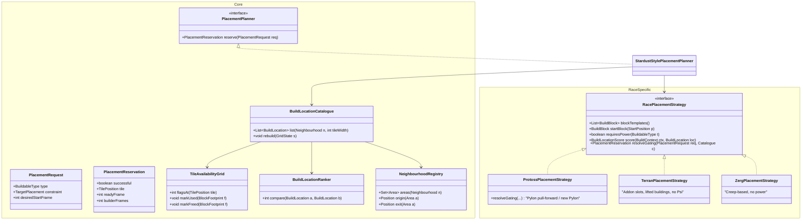

# Track 3: Building Placement — Reverse Engineering Stardust's Algorithm

## STATUS 2026-10-18 (read this first — what moved since the list below)

- The legacy path still builds through `APositionFinder` by default
  (item 1 stands); the JBWAPI `hasPath` source patch builds Pylons
  through it, so placement is not the blocker it was.
- Landed on top, doctrine unchanged: a last-resort Pylon ladder (strict
  → relaxed margins → first engine-buildable tile) and power
  pull-forward for unpowered catalogue sites (NEXT #81, Phase 4 partial).
- Terran/Zerg stubs, wall-gap measurement, coarse Pylon pull-forward,
  unplaced expansion/fortification policy, Chebyshev `distanceToExit`,
  simplified scan order and missing start-block variants (items 2–8)
  all stand as written.

Everything below this block is the design. **Protoss placement is implemented and
acceptance-tested (28 tests); these are the gaps that remain.**

1. **The cut-over has not happened.** `APositionFinder` is still the default
   planner. `PLACEMENT=catalogue` selects the new one, but it **only applies to
   Production V2**, and V2 is off unless `PRODUCTION_V2=LIVE` is also set. So in
   the default configuration the new planner is never reached, and the legacy
   path still fails: every 2026-10-09 OpenBW run logs
   `0:39: Can't find place for Pylon` from `NewConstructionRequest`.
   **Corrected 2026-10-09:** an earlier version of this list claimed the flag
   fixed placement in a live game (`Can't find place for Pylon` zero). That was
   measured with `PRODUCTION_V2=LIVE` in the same command and is **not** the
   default; treat the fix as unverified until an end-to-end run (see NEXT #47)
   places a Pylon without special flags. Note `PLACEMENT` must be read through
   `Env` (an ENV FILE flag), not `System.getenv`.
2. **Terran and Zerg placement are stubs.** `TerranPlacementStrategy` and
   `ZergPlacementStrategy` answer "available everywhere, no templates". Not
   implemented: Terran addon availability, lift/land (the grid has no `SOFT_USED`
   flag), wall-off, and Zerg creep-based availability. Each is a strategy
   implementation, not a core change.
3. **The wall does not measure its gap.** `ForgeGatewayWall` returns three tiles
   that fit, are non-overlapping and power each other - but it does not measure the
   hole the wall leaves, does not classify tiles inside vs outside it, and does not
   compute probe-blocking spots. **A wall with a one-tile gap that a unit can walk
   through would still be accepted.** Stated in `limitations()`.
4. **The Pylon pull-forward is coarse.** A candidate that needs power asks for a
   Pylon near it through the legacy queue and re-decides next pass
   (`NEEDS_NEW_PYLON`). Not implemented: Stardust's finer rules - comparing a new
   Pylon against the current best by a builder-travel buffer, and pulling an
   already-committed-but-unplaced Pylon earlier with `shiftOne`.
5. **Expansion, and the rest of the base-fortification policy, are not placed.**
   `CannonFortificationPolicy` covers how many cannons a base wants; the expansion
   decision (C14), cancelling a failed expansion (C15), and the DT-detection Pylon
   priority (part of C11) are not in the planner. C14/C15 are policy work (S5).
6. **`distanceToExit` is Chebyshev tile distance, not a real path.** Stardust does
   a pathing pass before its final ordering; this does not. Deliberate (a path per
   candidate is the cost the catalogue exists to avoid), but it means the exit
   weighting is approximate.
7. **The block scan order is simplified.** One stamping pass, first fit wins per
   origin, top-left to bottom-right. Stardust scans largest-template-first from the
   map centre. Both are deterministic; the interior-biased ordering is not ported.
8. **No start-block variant beyond four.** Stardust has ten; the six edge-case
   variants for unusual mains are not ported.

**What IS done and tested:** the tile grid and its margin rules, the 24 normal
block templates as data, the start-block anchor, the catalogue (highest-quality
candidates, blocks before scan), exact-tile handling (honoured only when free),
Psi gating and the pull-forward verdict, availability ordering, the distance
weighting, the choke-cannon preference, the Forge/Gateway wall geometry, the
fortification policy as goal generation, and the race extension point.

---

> **Layout of this document:** §1-§3 are the Stardust algorithm as read from its
> source - reference for the parts not yet ported, not a description of our code.
> §4 is the port plan and the class breakdown (what `atlantis.placement` follows).
> §5 is the legacy inventory and the staged plan, with each stage's status.
>
> Source of truth: `/sc-ai/Stardust/src/Builder/BuildingPlacement.{h,cpp}` (~1,270 lines),
> `Builder/Block.{h,cpp}`, `Builder/Blocks/**`, `Builder/ForgeGatewayWall.h`.
> Consumed by `Producer/Producer.cpp` (`reserveBuildPositions`, `choosePylonBuildLocation`).

---

## 1. Conceptual Model (What Makes This Approach Work)

Stardust does **not** search for a single tile when a building is requested. Instead it
precomputes, once per map-state change, a **catalogue of all valid building locations on the
whole map**, grouped by base "neighbourhood" and by building width. Placement then becomes a
cheap lookup + scoring operation against that catalogue.

Three ideas are load-bearing:

1. **Blocks (prefab templates).** Instead of evaluating 1×1 tiles, Stardust stamps
   hand-designed rectangular layouts ("Blocks") across the map. A Block already knows where its
   Pylon goes, which tiles are small (2×2), medium (3×2), large (4×3), and where cannons go.
   This encodes human Protoss base-design knowledge (gateway spacing, tech building adjacency)
   for free.
2. **Tile availability bitmap.** A single `uint` per map tile tracks: unbuildable/blocked (=1),
   blocked-adjacent (=2 from buildable side), used-by-block (=4), block-border (=8). Blocks are
   only stamped where every tile they occupy passes `checkTile`.
3. **Lazy, event-driven recomputation.** The catalogue is rebuilt only when `updateRequired`
   flips (building queued/cancelled/created/destroyed, base taken/lost, choke changed, enemy
   rush detected, hidden base discovered). Between rebuilds, only `framesUntilPowered` is
   refreshed per frame. This is why Stardust can afford a whole-map scan.

---

## 2-3. Stardust algorithm and Producer consumption (reference, not our code)

Source of truth (read it there, not here): `/sc-ai/Stardust/src/Builder/BuildingPlacement.{h,cpp}`,
`Builder/Block.{h,cpp}`, `Builder/Blocks/**`, `Builder/ForgeGatewayWall.h`,
consumed by `Producer/Producer.cpp` (`reserveBuildPositions`, `choosePylonBuildLocation`).

Phases, one line each (full step-by-step in git history):

- **0. Init:** per-tile availability bitmap (`1`=unbuildable, `2`=adjacent,
  base/geyser protection); neighbourhood sets (Main/AllMyBases/HiddenBase)
  with origins and exits.
- **1. Start block:** prioritized template list per base (`StartNormalLeft`
  first); registers power pylon + first cannon; warns and degrades on miss.
- **2. Base static defense:** choke-end analysis per base; main-base cannon
  order (mineral line, start block, rest by score).
- **3. Block stamping:** 24 templates largest-first, outward from map center
  in four quadrants; `tryCreate`/`place`/`placeLocations`/`removeUsed`.
- **4. Main-choke cannon:** closest powered `small` 3-8 tiles from choke,
  else whole-main scan; feeds DT-detection Pylon priority.
- **5. Catalogue:** `[neighbourhood][tileWidth]` lists with `poweredAfter`,
  `builderFrames`, `framesUntilPowered`, `distanceToExit` (large buildings
  near the main exit inverted); sorted by `BuildLocationCmp`.
- **6. Ranking (strict order):** start-block power pylon, DT choke pylon,
  geyser, earliest `framesUntilPowered`, no-exit-before-exit (medium),
  unconverted first, distance score (tech/rush-mode: away from exit).
- **7. Maintenance:** `buildAwayFromExit` flip, hidden base, per-frame
  `updateFramesUntilPowered`; invalidation on queue/cancel/create/destroy/
  choke events; `updateAvailableGeysers`.
- **Producer:** Pylon pick scores newly-powered medium/large slots (keep
  >=2/>=2, early-exit on 0); Psi buildings take powered-at-startFrame or
  pull the earliest committed Pylon earlier (`shiftOne`) or queue new
  (beats best by 250f builder-travel buffer); Stargate tie-breaks on
  `builderFrames`; `reserveBuildPositions` tentative-then-commit so no
  tile double-books.

## 4. Port Plan for Atlantis (Java 1.8) — Clean Rewrite, No Legacy Reuse

**Decision: burn the bridges.** The existing Atlantis `APositionFinder` is **not** wrapped,
**not** adapted, and **not** kept as a temporary shim. Placement is rewritten from scratch in
the new production layer. The legacy `APositionFinder`, `RefreshConstructionPosition` and the
`constructions/builders/position` recovery classes are treated as dead code and deleted in the
same cut-over as the queue. There is no incremental "wrap the old finder" milestone — the new
planner is the only implementation, and the old path is removed once the Producer cut-over is
green.

### 4.1 Race-agnostic core vs. race-specific strategies

Stardust's placement is Protoss-shaped (Psi power, Pylon gating, cannon chokes). The rewrite
splits this explicitly into a **race-neutral core** and **race plug-in strategies**, so no
Protoss assumption leaks into shared code.

### 4.2 Class breakdown (all new code, single responsibility)

**Race-agnostic core (`atlantis.placement.core`)**

| Class | Responsibility |
|---|---|
| `PlacementPlanner` (interface) | The contract consumed by `ProductionScheduler` (see `01_PRODUCTION.md`). |
| `PlacementRequest` / `PlacementReservation` | Immutable in/out value objects. |
| `StardustStylePlacementPlanner` | Orchestrator: builds/refreshes catalogue, delegates gating to the race strategy, returns a reservation. Owns all state (no statics). |
| `TileAvailabilityGrid` | Per-tile flags: `BLOCKED=1`, `ADJACENT=2`, `USED=4`, `BORDER=8`; base/geyser protection rules applied via hooks, not hardcoded. |
| `BuildBlock` (abstract) + concrete `Blocks/*` | Prefab layout: `tryCreate`, `place`, `placeLocations`, `removeUsed`, `width`, `height`. |
| `BuildLocation` (immutable value) | Tile, builderFrames, framesUntilAvailable, distanceToExit, isTech, plus strategy-opaque payload for race extras. |
| `BuildLocationCatalogue` | Emits + caches the `[neighbourhood][tileWidth]` lists; rebuild on invalidation. |
| `BuildLocationRanker` | Configurable comparator; ordering rules come from the strategy, not hardcoded. |
| `NeighbourhoodRegistry` | Named area sets + origins + exits (race strategy may define extra neighbourhood names). |
| `PlacementInvalidationListener` | Maps Builder/Units/base events to `invalidate()`. |

**Race-specific strategies (`atlantis.placement.race`)**

| Class | Responsibility |
|---|---|
| `RacePlacementStrategy` (interface) | The single extension point for racial differences. |
| `ProtossPlacementStrategy` | Psi gating, Pylon scoring/pull-forward/new-pylon logic, start-block cannon selection, choke-cannon + DT-detection priority, Protoss block templates. |
| `TerranPlacementStrategy` | Addon slots, lifted/landed building reservation, wall-off priority, no Psi. |
| `ZergPlacementStrategy` | Creep-based availability, no power, minimal block templates. |

**Deletion list (same cut-over as the Producer rewrite):**
`APositionFinder`, `RefreshConstructionPosition`, all `constructions/builders/position*`
classes, and the placement-related caches keyed off the legacy `Construction` object.

### 4.3 What lives in the core vs. what lives in the strategy

| Concern | Core | Strategy |
|---|---|---|
| Tile gating bitmap construction | Yes | Provides base/geyser protection hooks |
| Whole-map block stamping loop | Yes | Supplies the template list |
| `[neighbourhood][width]` catalogue | Yes | Supplies neighbourhood definitions |
| Ranking *mechanism* (comparator plumbing) | Yes | Supplies the weighted score / ordering rules |
| `framesUntilAvailable` computation | Yes | Interprets it ("powered" for Protoss = 0 when Psi satisfied) |
| Gating resolution ("can this be placed now?") | Delegates | Protoss: Pylon pull-forward / new Pylon; Terran: Addon dependency; Zerg: creep spread |
| Start-block selection | Delegates | Race-specific template list |

This keeps the core genuinely reusable: adding Terran later is a new `RacePlacementStrategy`
implementation plus Terran block templates — **zero edits** to the core (OCP on the race axis).

### 4.4 Implementation staging (rewrite, not wrap)

1. **Core skeleton:** `PlacementPlanner` interface + `PlacementRequest`/`PlacementReservation` +
   `TileAvailabilityGrid` + `BuildLocation` + `BuildLocationCatalogue` + `NeighbourhoodRegistry`.
   Unit-testable with a synthetic tile array (no BWAPI).
2. **Protoss strategy, blocks:** `BuildBlock` + start-block variants + the 6 largest normal
   blocks. Delivers the bulk of practical gains.
3. **Protoss strategy, gating:** Pylon scoring, pull-forward, new-Pylon creation, choke-cannon
   and DT-detection priority; full 24-template list.
4. **Cut-over + deletion:** swap `ProductionScheduler` to the new planner, flip the feature flag,
   then delete `APositionFinder` and the legacy position-recovery classes. No coexistence period
   beyond the flag flip.

### 4.5 Terran/Zerg differences considered up front (design only, not implemented)

Captured now so the core contract does not have to change later:

- **No Psi gating (Terran/Zerg):** `framesUntilAvailable` semantics differ. For Protoss it is
  dominated by Pylon timing; for Terran it is dominated by *Addon availability* (a Barracks
  needing a Tech Lab/Reactor) and *lift/land* mechanics; for Zerg by *creep coverage*. The core
  only exposes `framesUntilAvailable` + a strategy hook to recompute it — no Psi concept leaks.
- **Addon/dependency slots (Terran):** the block templates must reserve a paired footprint for
  the Addon. The `BuildBlock` contract therefore carries a list of `BuildLocation`s of arbitrary
  size (not just width 2/3/4), so Addon slots are first-class, not a special case.
- **Lifted buildings (Terran):** a placed building can be temporarily invalidated in place. The
  core must treat "currently occupied by a lifted building" as `USED` but not permanent — the
  grid needs a `SOFT_USED` state distinct from hard `USED`.
- **Creep (Zerg):** availability depends on terrain + creep growth over time, so
  `framesUntilAvailable` must be able to depend on a projected creep front, not just a static
  power check. The strategy hook signature already allows this (it receives the catalogue +
  request, and can consult arbitrary game state).
- **Wall-offs:** Protoss choke-cannon and Terran wall-off are both "choke-shaped" concerns but
  are computed differently; the core exposes choke geometry via `NeighbourhoodRegistry` (exits),
  while wall construction stays entirely in the strategy.

**Consequence for the contract:** the domain type is named `BuildableType` (not
`BWAPI::UnitType`-centric) and `BuildLocation` carries a strategy-opaque payload, so no
Protoss-specific field (e.g. `powersMedium`) is baked into core. Protoss Pylon powering is
represented in `ProtossPlacementStrategy` as a strategy payload attached to `BuildLocation`.

### 4.6 Risks / caveats to carry over

- **No legacy fallback.** Because we burn the bridges, the cut-over must be guarded by a feature
  flag and validated in CIG A/B before deleting the old code. There is no "fall back to
  `APositionFinder`" safety net — the net is the flag + pre-cut-over test coverage.
- **`framesUntilAvailable` is approximate** (Stardust has an explicit TODO here): times are
  estimated and a Pylon (or Addon) may itself shift later. Accept the same imprecision, but keep
  it isolated inside the race strategy so the core stays deterministic and unit-testable.
- **Whole-map stamping cost** is O(map area × template count) at init and on invalidation.
  Measure in profiles; cache per starting location if it ever becomes a bottleneck.

---

## 5. Legacy Atlantis Building/Project-Assembly Inventory — Treated as Suspect

**Starting position: everything Atlantis currently does around building placement, ordering,
and base fortification is presumed wrongly designed, redundant, or obsolete until proven
otherwise.** The existing code is not a baseline to preserve; it is a list of requirements to
re-derive from scratch. This section inventories it functionally (not class-by-class) so the
rewrite can decide, per capability, whether it becomes a core responsibility, a race strategy
responsibility, a later stage, or is dropped.

Concrete legacy surface observed under `src/atlantis/production/`:

- `constructions/**` — ~94 classes: `ConstructionRequests`, `Construction`, `RequestBuild`,
  `RequestCannonAt`, per-race build request helpers, `ConstructionsCommander` + recovery
  sub-commanders (`ConstructionStatusChanger`, `ConstructionThatLooksBugged`, `IdleBuildersFix`,
  …), and `constructions/builders/position*` (the tile-search path coupled to `APositionFinder`).
- `dynamic/protoss/ProtossSecureBasesCommander` + `dynamic/protoss/reinforce/**`
  (`ShouldSecureProtossBase`, `ProtossSecureBaseWithCannons`, `RequestCannonAt`) — the
  "secure a base with Photon Cannons" feature.
- `dynamic/expansion/**` (`ExpansionCommander`, per-race expansion commanders) — base expansion.
- `dynamic/**` generally — worker/supply/tech/army goal emitters interleaved with the queue.

### 5.1 Capability inventory (existing) → target home

| # | Capability (legacy) | Where it lives today | Target home in rewrite | Stage |
|---|---|---|---|---|
| C1 | Choose a valid tile for a generic building (no Psi, no choke semantics) | `APositionFinder` + `construction*` | Core: `BuildLocationCatalogue` + `BuildLocationRanker` | **S1** |
| C2 | Reserve/commit a tile so it can't be double-booked | `ConstructionRequests` / queue | Core: catalogue `tentative/commit` | **S1** |
| C3 | Prefab base layouts (gateway/tech adjacency) | none (ad-hoc) | Core `BuildBlock` + race block templates | **S2 DONE** |
| C4 | Start-block anchor for a base | none reliable | Race strategy: start-block templates | **S2 DONE** |
| C5 | Protoss Psi gating (tile powered / soon-powered / Pylon pull-forward) | scattered in `constructions` | Race: `ProtossPlacementStrategy` | **S3 DONE** |
| C6 | Probe travel-time estimate for a candidate tile (`builderFrames`) | partial, per-case | Core (compute) + Race (interpret) | **S2 DONE** |
| C7 | Distance-to-exit weighting (map-facing vs. choke-facing) | `APositionFinder` heuristics | Core via `NeighbourhoodRegistry` + ranker rules | **S3 DONE** |
| C8 | Executing the build with a chosen worker (issue `build` command, handle death/retry) | `ConstructionsCommander` + `builders/**` | Producer `OrderIssuer` / `BuildingOrderDirector` (see `01_PRODUCTION.md`) | **S1** |
| C9 | Choke geometry (main/natural chokes, exits) | `Map`/`Chokes` (keep) | Core `NeighbourhoodRegistry` | **S3 DONE** |
| C10 | Forge/Gateway choke wall construction | partial | Race: dedicated wall strategy (own document) | **S4 DONE (no gap measurement)** |
| C11 | Main-choke defensive cannon placement (DT detection) | none solid | Race: `ProtossPlacementStrategy` | **S4 DONE (cannon proximity)** |
| C12 | "Secure a base with cannons" policy (how many, where, when) | `ProtossSecureBasesCommander` + `reinforce/**` | **Policy, not placement** - emitted as goals | **S5 DONE (count)** |
| C13 | Cannon count heuristics per matchup (mutas, zerg supply tiers, mineral thresholds) | `ShouldSecureProtossBase` | `placement/policy/CannonFortificationPolicy` | **S5 DONE** |
| C14 | Base expansion decision (when to take a base) | `dynamic/expansion/**` | Producer goals + a future `ExpansionPlay` (see `02_COMBAT.md`) | **S5** |
| C15 | Cancel an in-progress/failed expansion | `ProtossCancelExpansionCommander` | Fall out of stateless recompute; no dedicated class | **S5** |
| C16 | Build-order-driven building requests | build orders → queue | `BuildOrderGoals` (see `01_PRODUCTION.md`) | **S1** |
| C17 | Dynamic building requests (supply, tech, army structures) | `dynamic/**` commanders | `DynamicGoals` contributors | **S2** |

### 5.2 Future / derived requirements (not yet in Atlantis, needed for parity)

| # | Requirement | Notes |
|---|---|---|
| F1 | Addon slots and dependencies (Terran) | Contract must allow arbitrary-width locations (see §4.5). |
| F2 | Lifted/landed buildings (Terran) | Grid needs `SOFT_USED` distinct from `USED`. |
| F3 | Creep-dependent availability (Zerg) | `framesUntilAvailable` must read a projected creep front. |
| F4 | Wall-off variants beyond Forge/Gateway | e.g. Pylon-wall, Terran supply-depot wall, Zerg no-wall. |
| F5 | Hidden/island base placement | `Neighbourhood.HiddenBase` already modelled; island handling TBD. |
| F6 | Re-expansion after losing a base | Falls out if expansion is goal-driven and placement is stateless. |
| F7 | Tournament-map-specific overrides (wall/choke choices) | Maps to Stardust's `Map::mapSpecificOverride()` hook. |

### 5.3 Critical boundary: placement ≠ policy

The most important reclassification: **`ProtossSecureBasesCommander` and its `reinforce/**`
helpers are NOT placement code.** They are a *policy* that says "this base should be fortified,
with N cannons, roughly here". That policy:

- belongs to the **strategy/Play layer**, expressed as ordinary `ProductionGoal`s
  (e.g. `Goal(Photon_Cannon, count=N, placement=Neighbourhood(base)|ExactTile(chokeSide))`),
- must **not** compute tiles itself — "roughly here" is expressed as a `TargetPlacement`
  constraint, and the `PlacementPlanner` resolves it to a real tile,
- must **not** carry its own mineral/supply thresholds (`A.minerals() >= 540`, zerg supply
  tiers, muta bonus). Those thresholds are goal-generation concerns and belong with the
  goal emitters, not in placement.

Consequently, the legacy `ShouldSecureProtossBase` heuristics are archived as *requirements
input for a future policy*, not ported into the planner.

### 5.4 Staged plan (status 2026-10-08)

Protoss is implemented; Terran/Zerg are contract-only. The exact gaps are in the
"NOT FINISHED" block at the top of this file - this is the map of where the code
lives, not a second list of what is missing.

| Stage | What it was | Where it is now |
|---|---|---|
| S1 | Core placement (grid, catalogue, ranker, seam) | `core/TileAvailabilityGrid`, `core/BuildLocation`, `core/BuildLocationCatalogue`, `engine/CataloguePlacementPlanner`, `engine/EngineTerrainSource` |
| S2 | Blocks + builder timing | `core/BuildBlock` (+ `Spec`), `blocks/BlockTemplates` (24 normal + 4 start, as data), `core/StartBlockFinder`, `builderFrames` in `CataloguePlacementPlanner.refine` |
| S3 | Protoss gating + ranking | `core/PsiGating`, `engine/EnginePowerSource`, `core/NeighbourhoodRegistry`, `engine/EngineNeighbourhoodSource`, `core/BuildLocationRanker` |
| S4 | Defensive placement | `core/ForgeGatewayWall` + `engine/EngineWallFinder`, `engine/ChokeAffinityRanker` |
| S5 | Base-fortification **policy** | `policy/CannonFortificationPolicy`, `policy/FortificationGoals`, wired into `DynamicGoals` |
| S6 | Race extension point | `core/RacePlacementStrategy` + `race/ProtossPlacementStrategy` (real), `Terran/Zerg*` (stubs) |

The join with Production V2 is one-directional and lives in
`DynamicGoals.addFortificationGoals`: policy emits goals with a neighbourhood
constraint, the planner resolves the tile. That is §5.3 expressed in types.

### 5.5 Deletion list (burn the bridges)

Deleted in the Producer cut-over, **not** before (see §4.6 on the missing safety net):

- `production/constructions/**` (all ~94 classes, including `builders/position*`).
- `production/dynamic/protoss/ProtossSecureBasesCommander`, `dynamic/protoss/reinforce/**`.
- Any placement helper coupled to `APositionFinder` / `RefreshConstructionPosition`.

Kept (not placement): `Map`/`Chokes`/BWEM wrappers, `information/**`, workers/mining, and the
`dynamic/**` *goal-intent* content — which is rewritten as `DynamicGoals` contributors, not
deleted wholesale.
